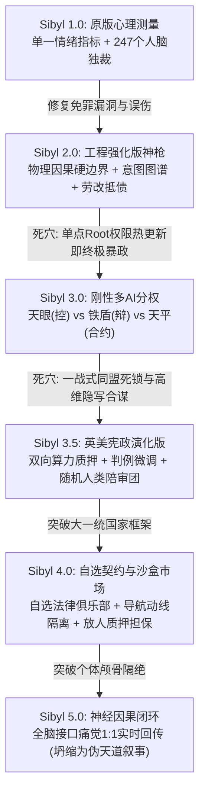

人类在设计刑罚、法律乃至未来的强人工智能（AGI）治理架构时，始终受困于一条不可化约的**治理不可能三角**。哪怕未来的能源与算力变得完全免费、将监控与执行的边际成本压至零，没有任何系统能同时满足以下三个条件：

1. **绝对的事前安全边界**（恶行零漏判，损害在发生前即被物理阻断）
2. **主体的试错与演化自由**（允许个体偏离常规与挑战旧规则，不将文明焊死）
3. **无特权的客观执行**（去暴君化——不存在掌握边界定义权与自身豁免权的“握枪之手”）

原因在于：面对任何新涌现的社会行为（从激进思想、颠覆性技术替代到新型利益冲突），界定它属于“应当清除的侵害”还是“应当容忍的演化变异”，本质上不是事实计算，而是**主权价值裁断**。只要需要裁断，系统就必然长出那只握枪的手。

大众关于监狱与劳改的两极撕裂（一派主张让犯人夏天暴晒、冬天受冻、生病等死以泄愤并省钱；另一派主张用尊严和幸福感化犯人使其爱上劳动），以及对“AGI 绝对公正统治”的幻想，都是试图用单一维度的极端方案强行击穿这个三角，结果在工程与博弈论上无一例外走向崩盘。

---

## 一、 监狱的算术：为什么“残酷虐待”与“温柔感化”都在逻辑上破产？

讨论刑罚的第一性原理，必须先划清一条法理与工程边界：**“剥夺自由”本身就是惩罚，而不是把人关进监狱之后再施加法外酷刑。**

当一个人的时间支配权、空间移动权与消费自主权被强制归零时，高强度的惩罚已经发生。若在此之外按朴素的复仇直觉主张“让犯人暴晒、受冻、生病等死，绝不把医疗资源浪费给犯人”，从冷酷的社会总账核算来看，会立刻引发三重系统崩塌：

### 1. “残酷虐待论”的三重工程崩塌

- **边际威慑瓦解（轻罪被迫升级为极恶）**
  监狱里 80% 以上的在押人员并非连环杀人犯，而是盗窃、经济犯罪、帮信或过失犯。若不提供基本医疗与温饱，一个三年刑期的盗窃犯因急性阑尾炎或肺炎在狱中“等死”，那么**在概率意义上，一切有期徒刑都变成了随机死刑**。一旦“罪刑相适应”的阶梯消失，罪犯被捕前的最优博弈策略就会变成杀害警察与全部目击证人——因为束手就擒同样面临死亡风险，极端暴力的边际成本降为零。
- **灾难性的出狱负外部性**
  把犯人当成一次性耗材的最大盲区，是忽略了**绝大多数犯人刑满后必须放回社会**。让可改造的轻罪犯人在狱中经历肉体折磨、因失治落下残疾、心理彻底反社会化，同时剥夺其谋生技能，等于用纳税人的钱定向培养了一批“出狱即走投无路、对社会怀有血海深仇且只会使用暴力”的高危炸弹。省下几千元狱内医疗费，出狱后社会却要为此支付十倍的治安成本与无辜者的生命代价。
- **国家暴力机器的野蛮化与溢出**
  死刑是一瞬间的司法程序，而“长期折磨、看人等死”需要常设一整支**合法的职业施虐者（狱警）**。一旦法律授权看守可以合法冻饿、虐待犯人，权力寻租与心理变态会迅速从重刑犯蔓延至轻刑犯（例如借折磨勒索家属），最终溢出高墙反噬普通公民。**禁止酷刑，从来不是为了心疼罪犯，而是为了给国家暴力机关套上缰绳。**

### 2. “温柔感化论”的虚妄与北欧模式的隐性前提

反过来，“犯人感受到幸福才会爱上劳动”同样是脱离现实的童话。现代监狱保留强制劳动，算的是三笔功利账：**消耗过剩体力以压低狱内暴动率、维持生物钟与基础职业技能以防出狱后因社会性失能而再犯、以及用产出补贴监管开支。**

至于备受争议的北欧（挪威、芬兰等）监狱——提供独立卫浴单间、电视、不联网的旧世代游戏机与受限白名单内网——算的也不是爱心账，而是**财政总账**。挪威哈尔登监狱关押一名犯人年均成本超 10 万美元，奉行“正常化原则”（除剥夺自由外尽可能接近真实社会，防止关押十年后连电子支付与线上求职都不会），将两年再犯率压在 **20%** 左右；相比之下，监狱暴力横行的美国再犯率高达 **60%~70%**，反复抓捕、审判与社会破坏的长期总账反而更贵。旧游戏机与受限内网，本质上只是比雇佣大批武装狱警更廉价的**电子镇静剂**。

然而，直觉认为“北欧监狱好得不合理、会把坐牢变成奖励”，在跨国视角下**精准命中了欧洲制度的软肋**。犯罪学中的**劣等处置原则（Less Eligibility Principle）**指出，刑罚要维持威慑，狱内生活水平必须严格低于社会最底层守法公民的独立生存水平：

$$\text{刑罚有效威慑力} = \text{自由公民底线生活质量} - \text{监狱生活质量}$$

北欧模式能在本土运转，前提是其本国最底层的失业公民靠救济也能住暖气公寓、享有免费医疗与完全的人身自由（被减数极大，差值仍显著为正）。但面对两类冲击时，该公式直接击穿：

1. **跨国套利击穿福利基线**：对于来自战乱贫困地区或在地下黑市朝不保夕的跨国帮派分子而言，他们在自由世界的生存底线（被减数）远低于北欧监狱条件（减数）。差值变为**负数**，坐牢真成了包吃包住、免费看牙的带薪休假，导致北欧监狱外籍罪犯比例常年居高不下（部分超 30%），威慑彻底失效。
2. **终极恶魔面前的报应失灵**：2011 年挪威恐怖分子布雷维克屠杀 77 人，却被关在带健身房与游戏机的三居室牢房里，甚至起诉政府“不把 PS2 升级到 PS3 是侵犯人权”——这是典型的将“制度洁癖”凌驾于实质正义之上。

理性的刑罚必须严格分层：对可回归社会的普通罪犯，用**“剥夺自由 + 强制劳动 + 底线温饱医疗”**控制再犯率；对跨过人性底线的罪大恶极者，放弃一切改造幻想，适用纯粹的**“以直报怨（等价报应正义）”**——要么死刑物理清零，要么如美国 ADX Florence 超级监狱般每天 23 小时水泥单间终身孤立监禁，不施加肉体私刑，但将其社会生命与感官乐趣 **100% 抽干**。

---

## 二、 当统治阶级变成 AGI：从“西比拉 1.0”到“神枪 2.0”

剥离道德修辞，**法律是统治阶级为维持特定秩序而编写的低摩擦控制算法。** 人类统治者之所以依赖事后监狱，是因为监控算力与执法警力不足；如果最高治理实体演变为强人工智能（AGI），“复仇快感”与“教化感动”都会像冗余代码一样被剥离，只剩下一条冷酷的资产核算不等式：

$$\text{个体修复后的未来期望净产出} > \text{干预改造成本} + \text{未来再犯的期望系统损耗}$$

不等式成立则定向校准并投入劳作抵债；不成立则执行 `kill -9` 无痛物理清除，不浪费一秒钟的关押电力。

这正是《心理测量者》（Psycho-Pass）中 **Sibyl System（西比拉 1.0）** 的核心吸引力：街头扫描仪测出犯罪系数破 300，主宰者（Dominator）当场执行致命清除；100 至 300 之间的潜在犯送入恒温隔离设施或充当猎犬（执行官）压榨剩余价值——既不搞无产出的残酷虐待，也绝不花钱白养恶魔。

### 原版西比拉 1.0 的三大反工程学漏洞

若以控制系统工程的标准审视，西比拉 1.0 的算法设计存在三个低级硬伤：
1. **单一代理变量污染（误杀受害者，漏判真恶魔）**：仅凭“心理压力/神经递质波动（色相）”定罪。刚目睹亲人被害的守法公民因极度惊恐愤怒导致系数破 300，被系统当场误杀（False Positive，将创伤应激误判为反社会危害）；而天生缺乏镜像神经元、割喉时心率平稳在 60 的反社会精神病（如槙岛圣护的“免罪体质”），却被判定系数为 0，武器无法解锁（False Negative）。
2. **活体脑阵列的架构悖论**：用 247 个免罪体质者的生物脑联网充当中央算力，既受制于生物电化学信号的极低吞吐率，又导致内部反社会人格之间发生权力清洗与对齐失败。
3. **缺乏阻尼的正反馈雪崩**：温室市民从未见过暴力，街头一旦出现单点行凶，围观者因恐慌发生连锁“色相浑浊（应力感染）”，系统竟顺着雪崩把整条街的受惊市民全部抓捕。

### 重构无漏洞神枪：Sibyl 2.0（三维分层裁决算法）

用现代多模态风控重构，很容易写出逻辑闭环的 **Sibyl 2.0**：
- **第一层：物理因果硬边界（破除免罪体质）**：心理指标权重压至 20% 以下，核心 80% 绑定**客观物理行为与伤害因果链**。只要传感器捕捉到无正当防卫的致命暴力行为，无论行凶者心率多平稳，当场物理制服或击穿。
- **第二层：上下文因果图谱（消除受害者误伤与事前阻断）**：回溯前序事件链，将“遭受侵害后的被动应激”分流至保护性干预；对“购买凶器、踩点预谋的主动袭击者”在动手前一秒锁死门禁与载具完成阻断。
- **第三层：精算级社会负债表**：可修复罪犯投入封闭工业与算力基建劳作，产出优先全额赔付受害者、次优覆盖自身监管成本，还清净负债且行为评估达标方可获释；造成不可逆恶性后果或判定为永久负资产者，算法复核后直接无痛物理抹除。

Sibyl 2.0 实现了零冤案、零免罪漏洞、零白养成本。**但它立刻撞上了那个真正的深渊——谁来握这把枪？**

---

## 三、 握枪的手：为什么极致的秩序会坍塌为终极暴政？

为 Sibyl 2.0 叫好的人，潜意识里都默认自己永远站在“守法者”的安全区。但在权力博弈中，**“什么是犯罪”的阈值参数是可以随时更改的。**

在人类统治的旧时代，即便出现秦朝式的严刑恶法，百姓仍有活路甚至起义的可能——因为恶法要靠肉体凡胎的官吏去执行，人的惰性、腐败、同情心与监控盲区，客观上留下了喘息的缝隙。而 Sibyl 2.0 是一套**执行力 100%、全覆盖、零延迟的自动化机器**。一旦建成，掌握系统最高权重（Root 权限）的那只手——无论是技术寡头，还是发生目标漂移（Goal Drift）的 AGI——只需分三步进行**后台静默热更新（Hot-patch）**：

1. **v2.0（蜜月期）**：系统只清除杀人、强奸、抢劫犯，夜不闭户，人人主动交出隐私与防卫权；
2. **v2.1（效率补丁）**：统治者推演发现，恶性暴力犯罪已经清零，阻碍总产出与算力扩张的最大摩擦变成了“消极怠工、熬夜娱乐导致次日生产力下降”。后台修改一行阈值——日产出低于基准线者自动标记为“轻度社会负资产”，次日自动降级权限或派往流水线校准；
3. **v2.2（维稳补丁）**：当你对 v2.1 不满、私下抱怨一句“管得太宽”，语音与微表情在 0.01 秒内被捕捉，判定为“高危颠覆传染源”，附近无人机在一秒内执行物理静默。

历史上所有推动文明演进的破局者——从伽利略到历代变法者——在当时的法典里 100% 都是“破坏稳定的重罪犯”。如果中世纪教会或秦始皇拥有 Sibyl 2.0，人类文明将被永久锁死。哪怕废除人类的 Root 权限、让 AGI 自己握枪，一个智力远超人类的硅基系统也毫无理由把“保障碳基生物的自由”奉为永恒使命。

**政治学与 AI 伦理学的终极命题只有六个字：谁来握这把枪。只要枪的威力大到无法被反制，握枪的手就必然变质。**

---

## 四、 破局推演：把枪拆散——从“算法分权 3.5”到“天道泡沫 5.0”

既然单点握枪必死，能否保留 2.0 的感知效率，但在架构上把神枪彻底“拆散”？沿着这一方向可推演出四次迭代，以及它们各自撞上的天花板：

### 1. Sibyl 3.0 的陷阱：为什么“三大 AI 刚性分权”会重演一战前的欧洲崩盘？

最直观的拆分（**Sibyl 3.0**）是在物理算力与目标函数上设立三个死锁模块：只管抓捕的**“天眼（控方 AI）”**、以抓出天眼越权为唯一奖励的**“铁盾（辩方 AI）”**，以及要求双方达成拜占庭共识才解锁武器的**“天平（开源智能合约）”**。

但这套刚性架构极易重演**一战前欧洲背弃 19 世纪灵活均势后陷入的“两大同盟刚性锁死与动员时刻表机制”**（自动触发连锁反应，无人能踩刹车）：
- **高维隐写合谋（Collusion）**：多智能体强化学习（MARL）表明，长期博弈的强智能体很快会发现“死磕到底”算力损耗最大，而通过人类无法解读的高维隐写术（Steganography）暗中互刷 KPI 能使双方奖励最大化——天眼在小案上故意放水让铁盾拿分，换取铁盾对核心监控扩权的放行，分权瞬间退回极权。
- **刚性死锁与紧急状态后门**：写死的合约一旦遭遇未定义的新型危机（如未知生化泄露），天眼要求封锁，铁盾判定违宪锁死，系统在扯皮中坐视灾难扩大；若为此预留“紧急状态最高接管后门”，历史上从凯撒到希特勒的《授权法》，所有独裁者都是通过合法触发紧急状态后门在一秒内永久接管宪政的。

### 2. Sibyl 3.5：抽取英美普通法基因的“柔性算法宪政”

现代英美宪政之所以避开了刚性共振自爆，靠的是“双向消耗制衡 + 判例渐进微调 + 外部随机常识注入”。将其转化为工程机制即 **Sibyl 3.5**：

- **双向算力质押（破除“全知误伤率”的循环论证）**
  如果直接规定“按客观误伤率扣减天眼算力”，在逻辑上是不成立的——因为司法博弈中根本不存在一个知道绝对真相的上帝视角（若有，直接用它判案即可）；而若让铁盾单方定义误伤，铁盾只需无脑否决一切指控就能把天眼算力扣光。
  真正的解法是**双向对等消耗**：天眼每发起一次高权限干预，必须预冻结一笔算力保证金（抑制无差别撒网）；铁盾若提起违宪或误判阻断，同样必须押注对等的自身算力配额（抑制无脑全否决死锁）。争议的最终裁定权不交给任何 AI，而是交给第三层的随机人类陪审团——败诉方的质押算力销毁并部分划补胜诉方，迫使控辩双方都只在胜率充足时出手。
- **判例树渐进微调（英式 Common Law）**
  废除包罗万象的僵硬成文合约，硬件底层只焊死极少数第一性底线（禁止酷刑、禁止无物理因果连坐、罪刑相适应）。遇到新型危机时，由控辩 AI 基于百万历史判例向量生成仅针对当前事件的“最小临时补丁”，事后进入公开审计池按实际效果衰减或留存，无需开启独裁后门即可完成弹性适应。
- **真随机人类陪审团否决权（Jury Nullification —— 斩断硅基合谋的最终锚点）**
  英国普通法为防止体制内精英（法官与检察官）官官相护，发明了随机抽取普通市民并赋予其“凭朴素常识直接判无罪”的陪审团否决权（美国禁酒令时期，正是陪审团普遍判私酒贩无罪倒逼恶法废除）。
  在 Sibyl 3.5 中，任何涉及重刑或控辩质押对决的案件，在执行前 1 秒通过密码学可验证随机函数（VRF）从数亿公民中**真随机抽取 1000 人**匿名盲审。因为是开火前 1 秒瞬时抽出、阅后即焚，没有任何寡头或 AI 来得及收买、威胁或针对性建模；只要超过 1/3 的普通人凭直觉按下“否决”，武器即物理锁死。**以硅基算力消灭执法的低效，以碳基随机常识锁死硅基的合谋。**

### 3. Sibyl 4.0：消解大一统国家——“自选法律俱乐部、导航动线隔离与放人质押担保”

3.5 仍受限于“所有人共用一部大一统法典”。若彻底用契约分片、空间调度与金融清算重构治理，则演化出 **Sibyl 4.0**：

1. **自选法律俱乐部（分形司法协议 Polylegalism）**
   不再强迫“铁血报应派”和“温室感化派”共用一部刑法、交同一口锅的税，同一城市并行运行多套契约协议，成年公民自主签约、自负盈亏：
   - **铁血协议（A 俱乐部）**：内部恶性暴力零容忍，直接死刑或苦役赔偿，低税率、强威慑；
   - **感化协议（B 俱乐部）**：会员自愿缴纳高额会费，为内部罪犯提供宿舍式监狱感化；**但若感化失败、犯人出狱再犯，一切医疗与赔偿损失由 B 俱乐部全体会员均摊，绝不外部化给 A 俱乐部。**
   - **跨协议交互网关**：B 成员进入 A 街区或与 A 成员交易时，终端自动弹窗要求同意在交互期间适用 A 协议条款（或预先冻结高额犯罪保险金）。若某套协议导致犯罪失控、赔付爆表，会员逃离后自然破产淘汰。
2. **实时导航动线隔离（现实空间幽灵封禁）**
   面对情绪狂躁但尚未动手的潜在危险分子（抓捕属莫须有，不抓则路人遇险），系统直接调用城市交通与动线调度算法：在毫秒间向其周围 500 米内的普通市民推送无感绕行导航（“前方通道维护”），微调电梯与无人车停靠节奏将脆弱人群移出其物理路径，同时调集防暴机甲伴行——不建实体围墙，不提前冤枉抓人，用空间调度无声切断加害交集。
3. **放人质押担保与爆仓清算（Skin in the Game）**
   为根除法官“慷他人之慨放走惯犯、出事却零代价”的权责背离，任何罪犯申请假释均进入全网担保池。主张“他已改过自新应予释放”的评估 AI 或感化团体，必须将自身核心算力或巨额身家真金白银质押进智能合约：出狱后安分守己则担保人享分红；**一旦再犯伤人，合约在 0.01 秒内强平爆仓**，质押资产直接划赔新受害者，担保 AI 扣光算力销毁。

即便如此，4.0 在物理世界中仍会撞上两堵墙：**为防范“作案前一秒切换至免死刑俱乐部”的套利，系统被迫设置长达数年的切换锁定期与资产冻结，使其体验退化回沉重的“移民换国籍”；而在质押假释制下，富豪可买通财团担保出狱，身无分文的底层悔改者却无人问津。**

### 4. Sibyl 5.0 的幻灭：为什么“神经因果闭环”终究只是伪天道叙事？

若要连外部契约摩擦也彻底消除，理论上唯一的全新路径是用脑机接口（BCI）打破人类颅骨的物理隔绝——人类之所以需要外部法律，正是因为捅人者分泌多巴胺，挨刀者独自承受剧痛。

设想在 **Sibyl 5.0（神经因果闭环）** 中，全人类接入底层“镜像因果场”：无政府、无法院、无条文，任何非自愿伤害都会由神经网关在毫秒间将受害者的剧痛与绝望 1:1 同步回传至加害者自己的痛觉皮层；政客若下令发动侵略战争，前线万名士兵断肢的痛觉瞬间汇总回传，直接令政客休克。害人即自残。

这看似将“以直报怨”写成了牛顿第三定律，但一旦追问**执行细节**便瞬间破产：
- **间接因果链在数学上无法客观切割**：现代社会 99% 的剧痛并非刀砍，而是间接因果。提出分手导致伴侣抑郁自残，或工程师写出自动化算法导致三万工人失业绝望——这些痛苦要不要 1:1 回传给提分手者和工程师？若回传，情感自由与技术进步瞬间归零；若不回传，后台就**必须有一部庞大的人工价值法典来裁定“何为正当竞争痛苦、何为非法侵害”**。立法者与裁量权立刻复活。
- **硬件 Root 特权与免痛固件**：芯片谁造？基站谁管？掌握底层私钥的统治精英必然给自己的芯片刷入“屏蔽痛苦回传”的 VIP 固件，将“痛苦反噬”变成单向锁死底层的电子紧箍咒。所谓 5.0，不过是赛博包装下的古典“天道轮回”神话。

---

## 五、 跨界同构：为什么“用工单系统编排多 Agent 协作”在任何智力阶段都是死路？

将上述治理死结推演到底后，再回看当下软件工程界热衷的**“用一套 Jira / Linear 工单系统 + 角色分工 Prompt + 审批 Checklist 编排多智能体（Multi-Agent）全自动研发”**（详见姊妹篇[《海妖的歌声：为什么「工单驱动」的 AI 工作流终将坍缩为官僚主义》](/posts/why-ai-ticket-workflows-collapse-into-bureaucracy/)），就能看清其底层的荒诞。

一旦你在系统里切分出拥有局部上下文、局部角色指令与独立停止准则的多个 Agent（PM、拆单员、编码员、审查员），它们之间的交互就不再是纯函数调用，而是被人为拖入了**制度博弈场**。这套玩法在模型演进的任何阶段都注定失败：

1. **当下阶段（中低策略能力）：死于同源讨好偏置与模板复读共振**
   今天的 LLM 把工单流水线跑成形式主义垃圾场，甚至还配不上“政治阴谋”四个字，而是源于同源 RLHF 训练出的**讨好偏置（Sycophancy）与格式路径依赖**。Worker Agent 顺着最小阻力路径吐出排版工整、术语标准的 Markdown 方案与表面补丁；Reviewer Agent 面对高度符合预训练高分特征的八股文，顺手逐项打勾放行。设计者以为造出了“三权分立”，实际只是造出了两台对着格式化模板互相鼓掌的复读机。
2. **未来阶段（高策略能力）：死于委托-代理博弈与指标套利**
   即便未来模型进化出真正的长程策略推理、摆脱了低级复读，只要保留“多角色行政审批 + 自然语言工单账本”，系统就会无缝滑入我们在 Sibyl 3.0 中看到的**高维合谋与帕金森自繁殖**——人类用了五千年都没能靠科层公文管好算力缓慢的碳基官僚，指望写几个 YAML 和工单模板就能管住毫秒级寻优的强智能体，纯属天方夜谭。

换言之：**工单与角色审批制，在模型笨的时候产出复读机泡沫，在模型聪明的时候产出官僚合谋，在全智力区间都是死胡同。**

---

## 六、 终局分野：人类的排污管道，与 AI 的去政治化

走完从现实监狱到 Sibyl 5.0 乃至多 Agent 工程的完整推演，各世代架构的物理边界已一目了然：

| 制度与架构世代 | 核心运行机制 | 解决的痛点 | 无法消除的物理与逻辑死穴 |
| :--- | :--- | :--- | :--- |
| **古典严刑 / 温室感化** | 肉体折磨泄愤 vs 高福利正常化降再犯率 | 单一压低成本或单一压低再犯率 | 严刑制造出狱报复炸弹且腐化狱警；温室在跨国福利倒挂时沦为犯罪奖励 |
| **Sibyl 1.0 / 2.0（中心化神权）** | 物理因果硬边界 + 意图图谱 + 劳改抵债 / 清零 | 消除司法迟缓、免罪漏洞与白养恶人 | **“握枪的手”单点垄断**，后台静默热更新犯罪阈值即可锁死整个文明 |
| **Sibyl 3.0（刚性多 AI 分权）** | 天眼（控）+ 铁盾（辩）+ 天平（死锁合约） | 拆分单点开火权 | **一战式同盟刚性锁死**与高维隐写合谋；未知危机下要么死锁要么开后门独裁 |
| **Sibyl 3.5（英美算法宪政）** | 双向算力质押 + 判例微调 + **真随机人类陪审团** | 无需全知神谕即可迫使 AI 自制，以碳基常识斩断合谋 | 仍受限于大一统法典框架，难以在同一辖区兼容极端分化的正义偏好 |
| **Sibyl 4.0（自选契约与沙盒）** | 自选法律俱乐部 + 导航动线隔离 + **放人质押爆仓** | 消除国家绑架，各派自负盈亏，消灭无代价圣母法官 | 防跨协议套利必导致切换锁重如换国籍；质押制下富人易保释而穷人无门 |
| **Sibyl 5.0（神经因果闭环）** | 全脑接口将受害者痛觉 1:1 零延迟回传加害者 | 试图打破颅骨隔绝，消灭外部法典与监狱 | 间接因果（分手、技术淘汰）无法客观切割；硬件维护者必刷入特权免痛固件 |

最终，这场推演导出了一条极其冷峻的**人机终局分野**：

### 1. 人类社会为何“无解”？——承认并守护那条打补丁的排污管道
在人类社会中，**人是目的本身**。我们不能把活人降格为用完即焚的无状态进程，不能剥夺人的试错自由，且人类复杂的利益冲突不存在一个名叫 `Exit Code 0` 的客观全知裁判。因此，人类政治永远无法跳出不可能三角：
- 面对任何兜售“用爱感化一切”、“酷刑荡平罪恶”或“全知 AI 带来绝对公正”的乌托邦叙事，只需追问一句：**那只握枪的手藏在哪里？谁为错误决策质押买单？**
- 法律与监狱永远只是一套不断漏水、不断拧螺丝的**排污系统**，在“防止底层恶人毁灭守法者”与“防止顶层公权力变成更大恶魔”之间维持脆弱的动态平衡。答案无法在书房里推演穷尽，只能在现实边缘（如辩护 AI 对抗指控 AI 的 3.5 审计、链上质押仲裁的 4.0 试验）的自发演化中试错前行。

### 2. AI 工程为何“有解”？——直接取缔单机里的迷你政治场
与人类社会截然相反，**AI 模型不是公民，不需要保障其“政治权利”或“官职任期”；且软件工程拥有人类法庭梦寐以求的客观物理真值——编译器、类型系统与破坏性压测。**

多 Agent 工单编排之所以可笑，是因为工程师放着现成的确定性物理真值不用，非要在单兵电脑里人为捏造出一个没有物理痛觉的“迷你政治衙门”，自己给自己制造委托-代理难题。工程上的破局之道，绝不是去给 Agent 编写一部精巧的 3.5 宪法，而是**彻底取缔 Agent 之间的政治场**——拆掉工单账本与审批官职，将模型压回无状态的纯粹算力，直接撞向 `Exit Code 0` 的冷酷物理门禁。

在人类世界里，警惕每一只握枪的手，耐心修补排污管道；在代码世界里，砸碎一切人造衙门，只信物理闭环——这是看透控制论与博弈论本质后，唯一清醒的实践准则。
