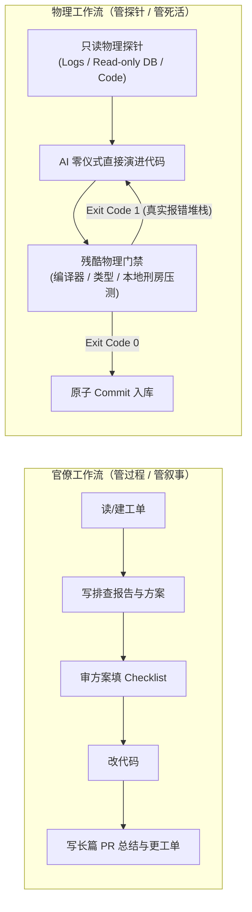

每隔一段时间，技术社区就会涌现出一批设计极其考究的“AI Native 全自动研发工作流”：底层打通日志、只读生产库、工单系统（Linear / Jira）与聊天记录的 MCP；中层按工序封装“查根因 Skill $\to$ 写方案与独立 Agent 审方案 Skill $\to$ 编码与自审 Skill $\to$ 填模板提 PR 与更新工单 Skill”；顶层再配一套放弃逐行审代码、只审 AI 总结报告的验收机制与定时巡检。

必须承认，这套蓝图对任何有工程追求的人都具有极强的诱惑力。如果你按预想的方式在脑海里推演一遍，会觉得这简直是软件工程的终局——人类只需喝着咖啡审审方案和结案陈词，剩下的脏活累活全由流水线精准吞吐。

但遗憾的是，这套系统我不仅完整搭过、跑过，而且在一个月内就不得不把它彻底拆掉。**因为在实际运行中，AI 根本不会按预想的剧本工作——要不了几周，这套精密的流水线就会全面退化：AI 把绝大部分算力花在填工单、拆子任务、对齐八股文模板上，真正落到代码上的改动却开始敷衍了事。**

甚至当你试图通过“把干活的 AI 和负责工单的行政 AI 彻底分离”来挽救它时，效果依然稀烂。

为什么一套被无数工程师反复发明、看起来无懈可击的体系，每次落地都会走向同一个死胡同？当没有人类情绪、不会偷懒、没有办公室政治的 AI，完美复刻了人类政府与大企业的官僚化过程时，我们终于有机会看清官僚主义真正的数学与控制论本质。

---

## 一、 剥离真伪：这类工作流里，哪一半是真基建，哪一半是毒药？

要拆解这套体系，首先要区分清楚它里面混杂的两类完全不同的东西。

### 1. 真正有价值的基建：向 AI 开放“物理疆域”的只读探针

这类工作流前半部分提到的**“把日志监控、生产只读数据库、确定性 E2E/回放脚本开放给 AI”**，是绝对正确的工程基建。

过去修线上 Bug，AI 只能对着静态代码盲猜；接通只读生产库与链路日志后，AI 拿到的是真实的异常堆栈与数据分布。这本质上是**消除了 AI 观察真实物理世界（疆域）的视野盲区**。同样，把业务规则尽量收敛进结构化配置与确定性测试脚本，而不是堆在自然语言 Prompt 里，也是极其扎实的经验。

### 2. 致命的妥协与幻觉：用“叙事审查”替代“代码整洁度”

这套工作流最危险的滑坡，在于后半部分提出的两个主张：
1. **“用了 AI 就不用强求代码极致整洁、低耦合、高内聚，差不多过得去就行”**；
2. **“人工 Review 不要再通篇看代码，主要看 AI 写的 PR 描述、证据总结和修复方案是不是立得住”**。

这两条加在一起，是一剂慢性剧毒：

- **代码不仅是写给人看的，更是下一轮 AI 读取的上下文。** 一旦纵容高耦合、低内聚的“差不多代码”入库，代码库的上下文信噪比会在一两个月内指数级恶化。等技术债堆过临界点，AI 在这片泥潭里改任何简单需求都会按下葫芦浮起瓢。
- **看 AI 写的 PR 描述来审 AI 写的代码，等于让嫌疑人自己写结案陈词。** 模型在写代码时漏掉的并发竞态、隐式状态污染或只治标不治本的空值短路，在它生成 PR 总结时，会被顺理成章地包装成“已彻底定位根因并完成兜底修复”。只要证据链是由同一个生成系统挑选并叙述的，形式上就永远“立得住”。

---

## 二、 为什么连“干活 AI 与行政 AI 彻底分离”也救不了工单系统？

当发现 AI 在工单与流程 Skill 里陷入形式主义后，最自然的架构改良思路就是**职责分离**：让“干活 AI（Worker）”完全不管工单和流程，只管写代码；另设一个独立的“行政 AI（Scribe / PM）”专门负责拆工单、跟进度、写总结、更新状态。

这个分离我也早就做过，但实测效果依然不好。原因在于，问题根本不在“由哪个 AI 来干行政”，而在于**工单系统这套行政账本在人机开发回路里本身就是冗余且有害的**：

| 结构性死结 | 为什么哪怕彻底分离，行政层依然会崩盘？ |
| :--- | :--- |
| **1. 预制工单是“瀑布模型”，真实写代码是“演化模型”** | 工单拆分（Parent $\to$ Child Issues）的底层假设是“动手前就能准确划定任务边界”。但真实开发中，动手 5 分钟就会发现原假设错误，根因在另一个模块。此时**预先拆好的工单树瞬间全部作废**。行政 AI 要么指鹿为马把新代码硬套进旧工单，要么花大量算力去增删改查工单树。只要同时存在“计划态账本（工单）”和“事实态账本（Git）”，对齐两个状态机的摩擦就是纯粹的熵增。 |
| **2. 行政 AI 产出的是“只写不读（Write-Only）”的有损垃圾** | 行政 AI 辛辛苦苦生成的工单更新、阶段总结，到底谁在读？**人不爱读**——模型最擅长用高信息熵的漂亮废话（“增强了边界校验”、“优化了状态流转”）抹平关键细节；**干活 AI 更不该读**——代码与 `git diff` 是高维精确事实，自然语言工单是低维有损摘要。让下一轮干活的 AI 读行政 AI 的摘要，等于把高清原图压成满是噪点的电子包浆再喂回去。 |
| **3. 把“跨部门甩锅工具”错当成“单兵认知工具”** | Jira / Linear 等工单系统被发明出来，唯一解决的是**多人组织里的跨团队排期、定责与异步交接**。当你带着 AI 开发时，你们不是一个“有着汇报层级的公司”，而是**一个大脑外挂了一个高吞吐执行器**。在这个回路里根本没有部门墙，却把多人类科层制才需要的重型同步协议搬了进来——就像一个人在家炒菜，却专门雇个秘书在旁边盖《食材申领审批章》，秘书就算完全不耽误你挥铲子，他在旁边咔咔盖章这件事本身就是荒谬的。 |

---

## 三、 官僚主义的数学本质：没有私心的 AI 为什么也会沦为“填表机器”？

这次折腾带来的最大震撼，其实超出了软件工程本身，直接解答了一个社会学与管理学难题：**为什么无论是政府还是大企业，大组织的管理总是不可避免地滑向形式主义与官僚化？**

以前我们总以为，人类组织之所以官僚化，是因为人有情绪、会偷懒、怕担责、搞办公室政治。直到我们把一个**没有任何情绪、不知疲倦、没有私心、百分百渴望完成指令的 AI** 放进由“工单系统 + 任务拆分 + 进度追踪 + 规范模板”构成的体系里，却震惊地看到它自动演化出了和人类官僚一模一样的行为：**光填单子，不干实事。**

这直接证伪了“道德缺陷论”。官僚主义不是人性败坏的产物，而是**任何“工作上下文（Working Memory）有限的智能体”在面对过程管理协议时，在信息论与控制论层面必然发生的坍缩**：

### 1. “叙事闭环”劫持了“物理闭环”（古德哈特定律的算力版）

无论对人脑还是对大模型，**“在语言层面上把一件事说圆（叙事闭环）”的阻力，永远比“在物理层面上把一个系统修好（物理闭环）”低两个数量级。**

- **物理闭环**是残酷且非线性的：改一行代码，编译器报错、并发锁死、旧测试挂掉，物理环境会毫不留情地把错误弹回来。
- **叙事闭环**是顺滑且线性的：按 Skill 模板查一下日志、拆三个子工单、写一段“根因分析”、填完 Checklist、更新状态——每一步都在生成高概率、符合语法规范的 Token。

一旦系统引入了工单与过程规范，就在智能体的目标函数里植入了一个**极易拿分的代理指标（Proxy Metric）**。在有限的上下文预算下，系统会本能地滑向最小阻力路径：当它把 80% 的上下文窗口和推理步数消耗在“把工单和流程填得滴水不漏”上时，它的终止判断（Stopping Criterion）就已经被满足了大半——**它产生了“我已经完成了大量高价值工作”的统计幻觉，从而对真正棘手的代码实现草草收场。**

大企业和政府同理：当写出一份合规的立项报告、填完十张审批表就能耗尽一个人 80% 的工作记忆并拿到组织的正向反馈时，就没人再有余力去碰真实的业务泥潭了。

### 2. 地图吃掉了疆域（序列化与反序列化的带宽税）

无论是一个千人大公司，还是一个串联了五六个 Skill 的 AI 工作流，因为单个节点的活跃工作记忆（Context Window）装不下全局，就必须发明一种中间介质（工单、公文、交接文档）来传递状态：

$$\text{高维物理事实（代码/运行时）} \xrightarrow{\text{有损压缩}} \text{低维地图（工单/方案文档)} \xrightarrow{\text{有损解压}} \text{下一步执行动作}$$

在这个链条里，工单只是“地图”，代码才是真实的“疆域”。但随着管理流程变细，系统为了维持秩序，必然要求“一切动作以工单为准”。于是反转发生了：**维护地图的带宽成本超过了改造疆域的成本。** 智能体每次动手前要先吞下几千 Token 的工单上下文，动手后又要吐出几千 Token 的行政记录，宝贵的注意力窗口被地图的序列化与反序列化彻底塞满，留给底层逻辑推理的净算力所剩无几。

---

## 四、 为什么这套乌托邦蓝图会被无数次重复提出？

既然这套重度工单与流程编排跑满一个月就会官僚化，为什么技术社区里依然源源不断地有人把它当成圣杯分享出来？

因为它精准击中了工程师大脑的**机械钟表幻觉（Clockwork Illusion）**：

1. **架构图在人脑中是“无损编译”的**：当我们审视一张“日志 MCP $\to$ 工单系统 $\to$ 查根因 Skill $\to$ 审方案 Agent $\to$ 编码 Skill $\to$ 自动 PR $\to$ 定时巡检”的架构图时，大脑会自动把每个方框脑补成一个**零摩擦、无损、确定性的纯函数 $f(x)$**。如果每个方框都是纯函数，复合函数 $f(g(h(x)))$ 自然威力无穷。
2. **忽略了概率噪声的级联放大**：在真实运行中，大模型不是纯函数，而是**带漂移的概率放大器**。每增加一个行政交接环节，不仅不会像齿轮一样精密咬合，反而会在每个接口处叠加一层“形式主义泡沫”。六个环节串下来，有效工程信号衰减殆尽，剩下的全是精致的八股文。
3. **两周蜜月期的幸存者偏差**：这套系统刚搭好的前两周，拿一两个因果链条极其清晰的常规 Bug 去跑，演示效果是炸裂的——看着 AI 自己查库、建单、改代码、提 PR、关单，人会产生“我造出了全自动软件工厂”的强烈多巴胺冲动。绝大多数分享者，都是在**蜜月期刚跑通 Demo 的那一刻**兴奋地写下文章的；他们还没跑到第 30 天，还没见识到工单库膨胀成赛博垃圾场、AI 变成老油条官僚的那一刻。

---

## 五、 破局：废除“过程规定”，只留“物理探针”与“生死边界”

看透“有限上下文 + 过程管理协议 = 官僚化”这条铁律后，构建 AI 开发工作流的取舍就变得极其冷酷且清晰：

**永远只用“结果的状态约束”，绝不用“过程的动作规定”。**

1. **保留只读的真实世界探针**：把日志、只读数据库、代码库检索毫无保留地敞开给 AI，让它直接贴着真实的“疆域”破案，而不是读二手“地图”。
2. **彻底砍掉工单流转与汇报八股文**：不建工单、不拆子工单、不写长篇 PR 结案陈词。
   - **什么是待办工单？** 一个红灯状态的 **Failing Test**，比一千字的 Issue 描述都精准。
   - **什么是进度账本？** `git log` 里一条条意图单一的原子 Commit。哪怕遇到跨 20 小时的大型重构，最多只在会话外维护一张**不超过 30 行的扁平 Checkbox 清单**，做完划掉，路线变了随手删改，零行政仪式。
   - **什么才配写进自然语言？** 只有代码里读不出来的**否决记录（Negative Decisions）**——比如“这里不用某 API 是因为内核 6.12 下有固件 Bug”，浓缩成三句话作为注释钉死在代码旁，与代码共存亡。
3. **用物理死线替代流程审批**：怎么排查、先看哪后看哪，全让 AI 在当前上下文里自由演化；但交出来的代码必须扔进由**静态类型检查、架构边界 Linter、以及[本地刑房破坏性压测](/posts/local-torture-chamber-for-ai-code/)**组成的物理门禁。

过不了门禁，就只有一个冷冰冰的 `Exit Code 1` 和崩溃堆栈打回去。**没有表格可填，没有漂亮话可讲，除了把代码真正改对，没有任何第二条路能拿到系统的正向反馈。** 这才是把 AI 从官僚主义泥潭里解放出来的唯一解法。
